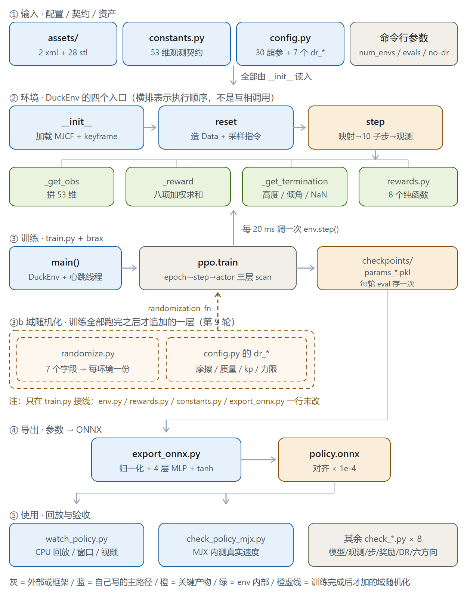
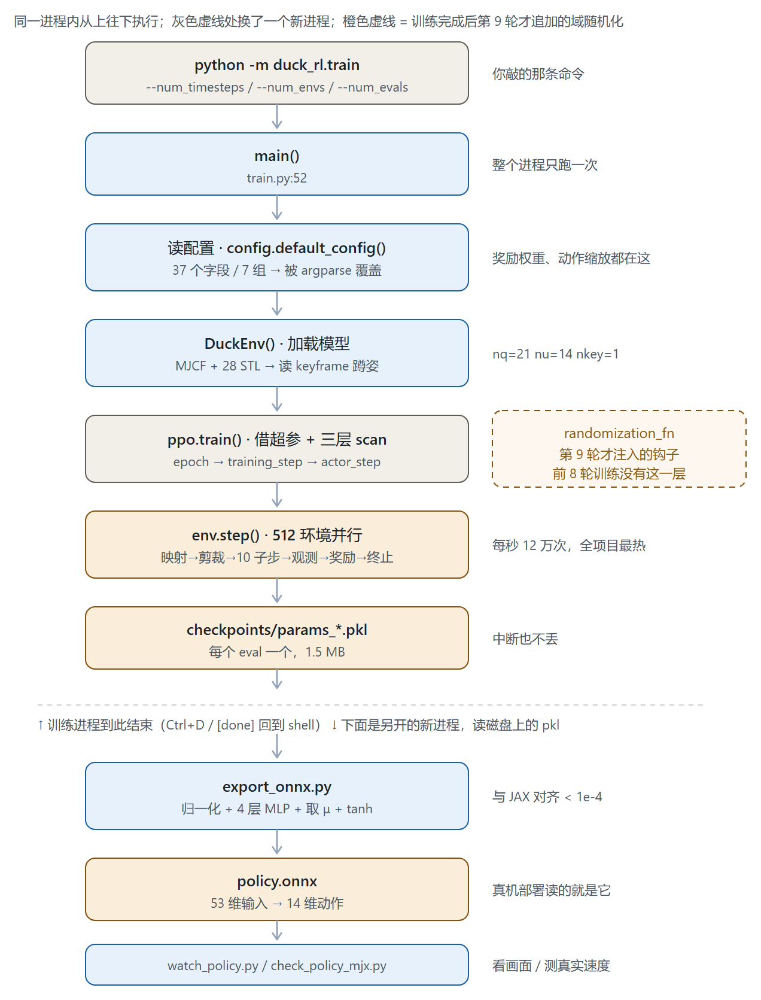

# duck_rl 代码导读

> **本文回答三个问题**：每个文件干什么、命令怎么串起来、该按什么顺序读。
>
> 项目位置 `~/duck_rl`（WSL 内部盘），共 **19 个源文件、2957 行**：
> `duck_rl/` 7 个（训练用 1352 行）、`scripts/` 12 个（验收用 1605 行）。
>
> 不放在这里的：九轮调参过程（见《训练实验记录》）、逐步执行命令（见《施工日志》）。

---

## 0. 一句话总览

只有**三条线**是主路径，其余都是辅助：

| 线 | 入口 | 干什么 |
|---|---|---|
| **训练线** | `python -m duck_rl.train` | 搭环境 → 借超参 → 跑 Brax PPO → 存参数 |
| **验收线** | `scripts/check_*.py` | 每一步单独验证：模型、观测、动力学、奖励、策略 |
| **部署线** | `export_onnx` → `watch_policy` | 参数导出 ONNX → 用 ONNX 在 MuJoCo 回放（等价真机） |

三条线共用同一个核心：`duck_rl/env.py` 里的 `DuckEnv`。

**域随机化不在这三条线上**，它是第 9 轮训练全部跑完之后才追加的**第四条支线**：
只挂在 `ppo.train` 的 `randomization_fn` 钩子上，`env.py` / `rewards.py` / `constants.py` /
`export_onnx.py` 一行没改。详见第 8 节。

---

### 全景图（建议先看这张）



五层从上到下：**① 输入**（MJCF 资产 / 观测契约 / 超参 / 命令行）→ **② 环境**（`DuckEnv` 的
`__init__` → `reset` → `step`，step 内部再调 `_get_obs`、`_reward`、`_get_termination`，
奖励公式在 `rewards.py`）→ **③ 训练**（`main` → brax 三层 scan → 存 `params_*.pkl`）→
**④ 导出**（→ `policy.onnx`）→ **⑤ 使用**（CPU 回放 / MJX 验证 / 验收脚本）。

**③b 是橙色虚线的附加层**：域随机化。它只在训练结束了八轮之后才出现，
用虚线画、位置在训练层下方、箭头只指向 `ppo.train` —— 表示它谁都不改，只给 PPO 喂参数。

颜色含义：**蓝** = 自己写的主路径，**灰** = 框架或外部，**橙** = 关键产物，
**绿** = `env.step` 内部，**橙虚线** = 训练完成后追加的域随机化。

### 执行时间线（从敲命令到看到鸭子走）



和上面那张的区别——**全景图看"文件之间怎么依赖"，这张看"一次运行按什么顺序走"**。

三个要点：

1. **配置和模型加载在 `main()` 里最先发生**，比 `ppo.train` 早得多。改超参、换 MJCF 都在这一步生效。
2. **虚线处换了一个新进程**：训练、导出、回放是三条独立命令，不是一次跑完。所以训练结束后
   `DuckEnv` 已经没了，导出时是重新读磁盘上的 `.pkl`。
3. **`env.step` 在 `ppo.train` 内部被调上亿次**，它是唯一在"训练"阶段反复执行的部分；
   右侧那个橙色虚线框就是第 9 轮才插进去的 `randomization_fn`。

---

## 1. 文件地图

### 训练用（`duck_rl/`，7 个文件 1352 行）

| 文件 | 行数 | 职责 | 什么时候读 |
|---|---|---|---|
| `env.py` | **368** | 核心：`DuckEnv`（reset/step/观测/奖励/终止）+ 三个坐标变换 + 指令采样 | **第一个读** |
| `rewards.py` | 94 | **八项**奖励纯函数（只有公式，权重在 config） | 想改奖励公式 |
| `constants.py` | 64 | **53 维观测契约**、关节名、`sensor_slice()` | 想确认数据长什么样 |
| `config.py` | 168 | 37 个字段 / 7 组（30 个超参 + `dr_enable` 与 6 个 `dr_*`） | 想知道能调什么 |
| `train.py` | 264 | PPO 入口、jax↔brax 兼容层、心跳线程、域随机化接线（3 行）、存参数 | 最后读 |
| `export_onnx.py` | 235 | 手搭 ONNX 图（含归一化）+ 与 JAX 数值对齐 | 要上真机前 |
| `randomize.py` | 159 | **训练完成后追加**：把 7 个字段做成 per-env 的 `randomization_fn` | 想做 DR 时 |

`randomize.py` 是唯一一个"不在主路径上"的文件——把它删掉，标准训练的前八轮照样跑。

### 验收用（`scripts/`，12 个文件 1605 行）

分两层：**先验环境对不对，再验策略行不行**。前者错了后面全白做。

| 顺序 | 脚本 | 行数 | 管什么 | 出错的表现 |
|---|---|---|---|---|
| ① | `check_model.py` | 225 | 模型读对没：质量/限位/质心/执行器/碰撞体 | 一切都不对 |
| ② | `view_model.py` | 59 | 静止姿态稳不稳（开窗口看） | 塌下去 / 抽搐 / 穿地 |
| ③ | `check_obs.py` | 61 | 观测拼对没（倾斜测试抓符号错） | 策略永远学不好，且不报错 |
| ④ | `check_step.py` | 89 | 零动作站立 / 乱动作摔倒 | 训练时表现怪异，像"学不会" |
| ⑤ | `check_reward.py` | 85 | 奖励量级 + 各项分解 | 曲线涨但行为不对 |
| ⑥ | `check_cmd_dist.py` | 54 | 指令采样分布（单轴率/侧移率） | 某方向学不会 |
| ⑦ | `check_dr.py` | 180 | 域随机化真的生效没（形状/范围/kp 同步/逐环境平均） | 训练了但没随机化 |
| ⑧ | `check_policy_mjx.py` | 105 | **单指令实测**：位移向量 + 累计偏航 | — 最终判据 |
| ⑨ | `check_all_dirs.py` | 117 | **六方向一次测完**，出达成率表 | — 最终判据 |
| ⑩ | `check_robust.py` | 284 | **改物理参数再测**（摩擦/质量/kp），比两个策略谁更抗 | — 决定该随机化什么 |
| — | `watch_policy.py` | 234 | ONNX 回放（窗口/视频/相机/倍速） | — 看效果 |
| — | `debug_export.py` | 112 | 导出对不齐时暴力枚举结构差异 | 导出报错 |

### 资产（`assets/`）

2 个 MJCF（本体 + 场景）+ 28 个 STL + `SOURCE.md`。`env` 加载 **scene** 而不是本体——
只有 scene 里有地面和 keyframe。

---

## 2. 训练命令的完整调用链

```
uv run python -m duck_rl.train --num_timesteps 40000000 --num_envs 512
│
├─ train.main()                                    ← train.py
│   │
│   ├─ DuckEnv()                                   ← env.py
│   │   ├─ mujoco.MjModel.from_xml_path(assets/scene_flat_terrain.xml)
│   │   ├─ m.opt.timestep = sim_dt                 ← 只同步步长，不动执行器参数
│   │   ├─ mjx.put_model(m)                        ← 模型搬到 GPU
│   │   ├─ default_pos = key_qpos[0][7:]           ← 初始蹲姿（14 个关节角）
│   │   └─ 缓存：gyro 传感器切片、ctrlrange 上下限
│   │
│   ├─ locomotion_params.brax_ppo_config("BerkeleyHumanoidJoystickFlatTerrain")
│   │   └─ 借现成超参：hidden=(512,256,128)、batch=256、unroll=20 …
│   │      覆盖 num_envs / num_timesteps
│   │
│   ├─ make_randomization_fn(env.mj_model, cfg)    ← randomize.py【第 9 轮才有的 3 行】
│   │   └─ 传 None 就是标准训练（--no-dr 或 dr_enable=False）
│   │
│   └─ ppo.train(environment=env, …, randomization_fn=rand_fn)
│       │                                          ← brax，不是我们的代码
│       ├─ 包装链：Vmap → Episode → AutoReset → 我们的 env
│       │   （Vmap 把单个 env 复制 512 份并向量化；AutoReset 在 done 时自动重置）
│       ├─ randomization_fn(model, key) → (model_v, in_axes)   ← 有 DR 才走这一步
│       ├─ env.reset(key) → State
│       └─ 循环若干 training step：
│           ├─ jax.lax.scan(actor_step, unroll_length=20)
│           │   └─ 策略(obs) → action → env.step(state, action)
│           ├─ 计算 GAE → 梯度更新
│           └─ 每 N 步 eval → progress_fn 打印 → policy_params_fn 存 .pkl
│
└─ 产物：checkpoints/params_<步数>.pkl
```

**你该关心的三层**：`env.step`（MDP 本身）→ `ppo.train` 的参数（超参 + `randomization_fn`）
→ `checkpoints`（产物）。

---

## 3. 一次 `env.step` 的六个动作（全项目最核心的 20 行）

```
     action（网络输出，14 维，范围 ±1）
        │
   ①   ├─ ctrl = default_pos + action * action_scale        ← 映射到关节目标
   ②   ├─ ctrl = clip(ctrl, ctrl_lo, ctrl_hi)               ← 每关节独立上下限
        │
   ③   ├─ mjx_env.step(model, data, ctrl, n_substeps=10)    ← 10 个物理子步 = 50Hz→500Hz
        │
   ④   ├─ obs = _get_obs(...)   → 53 维（含 yaw 两维）
   ⑤   ├─ reward, terms = _reward(...)  → 八项加权
   ⑥   └─ done = 摔倒 or 超时
```

对应代码位置（`env.py`）：

| 步 | 函数 | 关键点 |
|---|---|---|
| ① | `step()` 前 3 行 | `action_scale=0.45`，±1 → ±26° |
| ② | `step()` clip 行 | 用 `m.actuator_ctrlrange`（14×2 数组），**不是标量** |
| ③ | `mjx_env.step` | 内部 `jax.lax.scan`，不要用 Python 循环 |
| ④ | `_get_obs()` | 顺序 = `constants.OBS_LAYOUT`，改一处要改三处 |
| ⑤ | `_reward()` | 八项加权，明细进 `metrics["rew/*"]` |
| ⑥ | `_get_termination()` | 高度 < 0.10 或倾斜 > 66° 或 NaN |

**域随机化改第 ③ 步用的 `model`，不改这六步的代码**——`env.step` 收到的 `model` 已经是
"属于这个环境的那一份参数"，它自己并不知道参数被换过。

---

## 4. 建议阅读顺序

### 第一档：40 分钟，抓住主干

| # | 读什么 | 读完能回答 |
|---|---|---|
| 1 | `env.py::step()` | 一个控制周期里发生了哪六件事？ |
| 2 | `env.py::_get_obs()` | 53 维分别是什么、从哪取？最后两维为什么是 sin/cos |
| 3 | `constants.py` | 契约的顺序和维度，为什么"改一处要改三处"？ |
| 4 | `env.py::_reward()` | 八项怎么加权成 4.3 分？ |
| 5 | `config.py` | 有哪些旋钮？哪些"不该放这里"？ |

### 第二档：再 40 分钟，看全貌

| # | 读什么 | 读完能回答 |
|---|---|---|
| 6 | `rewards.py` | 每项为什么用 `exp(-e²/σ)` 而不是 `-e`？ |
| 7 | `env.py::reset()` | 初始状态怎么来的？为什么必须 `mjx.forward`？ |
| 8 | `env.py` 三个坐标变换 | 为什么重力要取旋转矩阵第三"行"？ |
| 9 | `train.py` | 超参从哪借的？为什么加 jax 兼容层？ |
| 10 | `export_onnx.py` | ONNX 图怎么搭的？为什么要和 JAX 对齐？ |

### 第三档：需要时才看

- `randomize.py` — 只在你打算加/改随机化项时读，**和主路径无关**（第 8 节有摘要）
- `scripts/check_*.py` — 都是独立的验收脚本，看一个就懂全部
- `scripts/debug_export.py` — 只在导出对不上时用
- `assets/*.xml` — 配合 `工程/MJCF逐段解析-open_duck_mini_v2.md` 读

---

## 5. 命令清单

| 命令 | 作用 | 期望 / 耗时 |
|---|---|---|
| `python -m duck_rl.constants` | 打印 53 维契约 | 立即 |
| `python -m duck_rl.config` | 打印全部超参（含 `dr_*`） | 立即 |
| `python scripts/check_model.py assets/scene_flat_terrain.xml` | 模型自检 | 秒级 |
| `python scripts/view_model.py` | 窗口看静止姿态 | 秒级，需关窗口 |
| `python scripts/check_obs.py` | 观测 + 倾斜测试 | ~2 min（含编译） |
| `python scripts/check_step.py` | 站立/摔倒测试 | ~2 min |
| `python scripts/check_reward.py` | 奖励量级 | ~2 min |
| `python scripts/check_cmd_dist.py` | 验指令采样分布（单轴率 / 侧移率） | 10 秒 |
| `python -m duck_rl.train --num_timesteps 40000000 --num_envs 512` | 训练（**默认带 DR**，`dr_enable=True`） | 40M ≈ 55 min |
| `python -m duck_rl.train --num_timesteps 40000000 --no-dr` | 标准训练，关掉 DR 做 A/B 对照 | 同上 |
| `python scripts/check_dr.py --fast` | 验 DR 生效（形状/范围/kp 同步） | ~1 min |
| `python -m duck_rl.export_onnx --params checkpoints/params_X.pkl --out checkpoints/policy.onnx` | 导出 + 对齐（**默认带归一化，别加 `--no-normalize`**） | ~1 min |
| `python scripts/check_policy_mjx.py --onnx checkpoints/policy.onnx --cmd 0.4 0 0` | MJX 里测策略，**唯一可信的速度数字** | ~1 min |
| `python scripts/check_all_dirs.py --onnx checkpoints/policy.onnx` | **六方向一次测完**，出达成率表 | ~2 min |
| `python scripts/check_robust.py --onnx A.onnx B.onnx --friction 0.3 0.6 0.95` | 换物理参数比两个策略 | 秒级/组 |
| `python scripts/watch_policy.py --onnx ... --viewer --hold --speed 0.5` | 开窗看走路，半速，跑完不关窗 | 实时 |
| `python scripts/watch_policy.py --onnx ... --viewer --hold --cam fixed --cam-distance 2.5` | 固定机位看位移 | 实时 |
| `MUJOCO_GL=egl python scripts/watch_policy.py --onnx ... --video out.mp4 --steps 250 --cam-elevation -40` | 出 5 秒视频（250 步） | 十几秒 |

**训练参数**：`--num_evals 50`（输出频率，越大越密）、`--num_eval_envs 64`（eval 开销）、
`--heartbeat 2`（心跳秒数，0=关）、`--dump-metrics`（打印所有指标键名，只打一次）、
`--no-dr`（关域随机化做 A/B 对照）。

**回放参数**：`--cam {follow,tracking,fixed}`（默认 follow=跟位置不跟朝向）、
`--cam-azimuth`（0=正前 90=正侧 180=正后）、`--cam-elevation`（负得越多越俯视）、
`--cam-distance`、`--cam-follow-gain`（0.97=几乎固定）、`--speed`（1.0 实时 / 0.5 慢放 / 0 不限速）、
`--hold`（跑完保持窗口）。

**指令 `--cmd vx vy wz`**：前后 m/s（正=前进）、左右 m/s（正=左）、转向 rad/s（正=左转）。

---

## 6. 七条不变量（改代码前必看）

| # | 不变量 | 破坏了会怎样 |
|---|---|---|
| 1 | **53 维观测顺序冻结** | 训练能跑但策略永远学不好，且不报错 |
| 2 | `reset` 与 `step` 的 `State` **逐字段同构**（`metrics`/`info` 用合并而非替换） | `scan` 报"pytree structure 不同" |
| 3 | `ctrl` 剪裁用 **14 维数组**（`m.actuator_ctrlrange`） | 左右 hip_pitch 限位镜像，用标量会把一条腿夹死 |
| 4 | 观测缩放系数（gyro×0.25、qd×0.05）训练/部署必须一致 | 输入量纲错，行为异常不报错 |
| 5 | ONNX 里的归一化开关必须与训练时 `normalize_observations` 一致 | 同上，而且极难发现 |
| 6 | CPU MuJoCo 回放要把 `iterations` 从 1 调到 50 | 会穿地，高度变负 |
| 7 | **DR 改 `kp` 必须同时改 `biasprm[1] = -kp`** | 伺服变成"只有前馈没有反馈"，力随 ctrl 线性增长，鸭子飞出去 |

第 7 条只在你动 `randomize.py` 时相关：MuJoCo 对 position 执行器自动设
`gainprm[0]=kp, biasprm[1]=-kp`，两个只改一个就废。

---

## 7. 踩过的坑（症状 → 根因 → 修法）

| 症状 | 根因 | 修法 |
|---|---|---|
| `carry input and output must have the same pytree structure`（0 → 2 键） | `reset` 返回 `metrics={}`，`step` 返回两键 | 两边都走 `_metrics()` |
| 同样的错（10 → 9 键，差 `reward`） | brax 包装层往 `metrics` 加了 `reward`，我们的 `step` 整字典替换 | 改成 `{**state.metrics, **新字典}` |
| `jax.device_put_replicated is deprecated` | brax 0.14.2 用了 jax 0.12 已删除的 API | `train.py` 顶部打兼容补丁 |
| 导出 ONNX 误差 1.86（第一次） | 以为是归一化开关反了 | 真因见下两行 |
| **导出"对齐通过"但策略行为错** | `verify` 重建 JAX 网络时**没传 `preprocess_observations_fn`**，参考实现也没归一化 → 两边都错 = 假阳性 | `verify_onnx` 传 `running_statistics.normalize`，和训练路径一致 |
| **策略"会站不会走"（第 1 轮）** | 一半是假象：BerkeleyHumanoid 配置 `normalize_observations=True`，导出却默认关 → 回放输入量纲差 3~30 倍 | `build_onnx` 默认 `normalize=True`；修完后同一份参数实测 **0.38 m/s** |
| 回放高度 −0.152 且不动 | 躯干没有碰撞体，翻倒后穿地；且 MJX/CPU 求解器迭代数不同 | 认清它是"翻了"，不是数值问题 |
| 站着能拿高分 | 站着能拿 84% 的分，走的风险大 | 压白给分 + 提高跟踪权重 + 放宽 action_scale |
| 策略「走着走着就歪了」 | 观测里没有 yaw —— `gravity` 绕 z 轴旋转不变，`gyro` 只给瞬时角速度 | 观测加 `[sin(Δyaw), cos(Δyaw)]` 两维，51→53 |
| **纯侧移指令它往后退** | 三维独立均匀采样，`[0, 0.3, 0]` 的联合概率只有 0.087%，4 万回合才 35 个样本 | 采样加「单轴模式」30% + `vy` 边界加权 |
| **加采样权重后前进走成弧线** | `vy` 边界加权给太多「斜着走」的暴露量，泛化到纯前进 | 先降到 0.25 试（无效），最终靠 heading 奖励解决 |
| **`tracking_ang` 拿满分却仍在漂移** | 它只约束「此刻转多快」，管不了「已经偏了多少」 | 加第八项 `heading`：直接比 `当前yaw` 与 `∫wz dt` 的差 |
| 偏航误差算出 2π 假误差 | 偏航在 ±180° 跳变（179 → −179） | 误差先 `arctan2(sin(e), cos(e))` 归一到 [−π, π] |
| `NameError: name 'jnp' is not defined` | `env.py` 用 `jp`，其余文件用 `jnp` | 已统一改为 `jp`（`env.py` 内） |
| 新训练指标看着很差但实测很好 | `heading=196/800` 只有 24.5%，因为 eval 回合指令随机 | **训练指标不能判断直线性，只能实测 30 秒累计偏航** |
| `check_dr` 报形状不匹配 `(8,) (14,)` | 先 `fl.min(1)` 再除，维度塌了 | 改成先相除再统计 |
| `check_dr` 报 `State object has no attribute qpos` | `State` 包了一层 | 用 `state.data.qpos` |
| `check_dr` 看力矩"没随机化" | 14 个 `U(0.8,1.2)` 取 `max` 必然是极值 | 改成逐环境平均 |
| `params_final.pkl` 不存在 | 训练被 Ctrl+C 中断，没走到最后一 eval | 用最新的 `params_<步数>.pkl` |
| 回差模型里 `kp` 变成 17.11 | 那份 xml 基于旧版本生成 | 加 `--force-kp` 隔离变量 |
| 回差模型 qpos 取错 | 关节与回差关节交错，固定切片 `qpos[7:21]` 静默取错 | 按 `m.actuator_trnid[:,0]` 索引（`check_robust.py` 已修，`env.py` 未改） |

---

## 8. 域随机化：训练完成**之后**才加的一层

> 这一节单独讲，因为最容易误解成"训练时就带着扰动"或"拿 exp8 再优化"。

### 8.1 时间顺序

```
第 1~8 轮   干净仿真里训练（摩擦 0.6、kp 分毫不差、质量精确到克）
            └─ 八轮跑完，主策略 policy_exp8.onnx 定稿：六方向 91~102%，30 秒偏航 3.0°
                    ↓
第 9 轮     才写 randomize.py，从随机初始化重训一遍 → policy_dr1.onnx
```

三句话定性：

- **不是**给 exp8 打补丁，**不是**拿 `policy_exp8.onnx` 继续训练或微调；
- **是**重新训一份权重，唯一区别是每步用的物理参数都从范围里现抽一份；
- 所以 `checkpoints/` 里两份并存、各有所长（第 9 节表格）。

### 8.2 改动面：只碰 3 处

| 位置 | 改了什么 | 规模 |
|---|---|---|
| `duck_rl/randomize.py` | **新增文件**：`make_randomization_fn()` | 159 行 |
| `duck_rl/config.py` | 加第 6 组：`dr_enable` + 6 个 `dr_*` 范围 | 8 行 |
| `duck_rl/train.py` | 3 行接线，把 `randomization_fn` 传给 `ppo.train` | 3 行 |
| `env.py` / `rewards.py` / `constants.py` / `export_onnx.py` | **一行未改** | 0 |

为什么能不侵入：brax 的 `ppo.train` 本来就有 `randomization_fn` 钩子，DR 是包在 env
**外面**的一层；观测、奖励、终止这些 MDP 定义完全不变，所以"加 DR"不需要动环境代码。

看 `train.py` 里那三行：

```python
rand_fn = make_randomization_fn(env.mj_model, env._config)   # 造函数
...
ppo.train(..., randomization_fn=rand_fn)                     # 交给 brax
# 关掉：--no-dr，或 config 里 dr_enable=False → rand_fn = None
```

⚠️ **现在 `dr_enable` 默认是 `True`**，所以今天直接跑 `train` 命令默认就带 DR。
想复现前八轮那种干净训练（复现 exp8 级别的直线精度），必须加 `--no-dr`。

### 8.3 训练时它怎么起作用

```
ppo.train(randomization_fn=fn)
   └─ jax.random.split(key, 512)              # 每环境一个 key
        └─ fn(model, key_i) → (model_i, in_axes)
             └─ 只把 7 个字段做成 per-env，其余字段共享同一份
```

不复制整个 model，只复制 7 个小数组：显存代价 ≈ 180 KB，实测训练峰值 2.0~2.5 GB（6 GB 卡无压力）。

### 8.4 六个维度 + 一个已知缺口

| 维度 | 范围 | 依据 | 实测效果 |
|---|---|---|---|
| 地面摩擦 | 0.3~1.0 | 瓷砖/木地板 0.3~0.5，橡胶垫 0.8~1.0 | 无差异（本身不敏感） |
| 关节库仑摩擦 | ×0.5~2.0 | 齿轮批次 + 磨损 | 未单独测 |
| 转子惯量 | ×0.8~1.2 | 辨识误差 | 未单独测 |
| **各 body 质量** | ×0.9~1.1 | 打印件填充率 + 电池 | ✅ **±15% 时抗扰能力 ×3.5** |
| 舵机 kp | ×0.8~1.2 | STS3215 个体差异 | 略好（位置伺服天生抗） |
| 力矩上限 | ×0.8~1.2 | 同上 | 未单独测 |
| **舵机回差** | **未随机化** | 需要额外自由度（31 维 qpos），模型已删 | ❌ 两版都偏 20°+/30 秒 |

**为什么只有质量提升明显**：DR 只对「既敏感、又训过」的维度有效。
质量既敏感又在范围内 → 提升 3.5 倍；摩擦训过但不敏感 → 无差异；
回差敏感但**完全没训过** → 好坏纯属随机，两版都崩。详见《训练实验记录》第 9 轮。

### 8.5 怎么验证它真的生效

- `scripts/check_dr.py`：检查形状、采样范围、`max|biasprm[1]+kp| = 0`、逐环境平均力矩。
  **不看这个脚本，"训练了但没随机化"是看不出来的**——训练曲线和标准训练几乎一样。
- `scripts/check_robust.py`：同一引擎下改 `geom_friction` / `body_mass` / `kp` 再跑，
  比两个策略谁更抗。`check_all_dirs.py` 在干净环境里测不出 DR 的差别。

---

## 9. 当前策略与下一步

### 能力清单

两个可用策略，用途不同：

| 策略 | 六方向最低 | 30 秒偏航 | 特点 |
|---|---|---|---|
| **`policy_dr1.onnx`** | **96.5%** | — | 第 9 轮 DR 训练；质量 ±15% 时比基线稳 3.5 倍；动作更平滑（`action_rate` −15%、`torque` −15%） |
| `policy_exp8.onnx` | 91.3% | **3.0°** | 八轮标准训练的定稿，无 DR，直线精度最高 |

细分能力（以 exp8 的实测为准，dr1 各项持平或更好）：

| 能力 | 达成率 | 备注 |
|---|---|---|
| 站立 `cmd=0` | — | 高度 0.15 稳定，不漂移 |
| 前进 0.4 m/s | 101.7% | 30 秒 12.31 m、速度 0.41 m/s |
| 后退 0.3 m/s | 97.1% | — |
| 左移 / 右移 | 93.3% / 99.8% | 横移 15 秒会斜 4~9°，物理限制 |
| 左转 / 右转 0.6 rad/s | 93.7% / 91.3% | 两侧对称，原地转位移 < 4 cm |
| 高速 0.8 m/s | ⚠️ 跑 7 秒后摔 | 训练分布边缘，未列入验收 |

### 下一步（上真机前要补的两项）

| 项 | 为什么 | 怎么做 |
|---|---|---|
| **舵机回差** | 唯一实测敏感的扰动（30 秒偏航 6 倍）。齿轮间隙 ±0.5° 打在位置伺服的软肋上 | 换 `backlash` 模型 + `env.py` 改成按 actuator 索引（支持 31 维 qpos）+ 重训 |
| **动作延迟** | 仿真输出立即生效，真机有 10~20 ms（半个控制周期），策略会"过度修正" | 在 `step` 里加动作队列，把延迟也纳入随机化 |

回差模型和对应场景 xml 已删除，`assets/` 回到 2 xml + 28 stl —— 因为回差需要先改
`env.py` 的索引逻辑再重训 2 小时，属于下一阶段的工作，不是遗漏。

### 一条贯穿全程的教训

**九个问题里有七个是「训练指标看不出来」的**：`eval_reward` 看不出走没走直，
`tracking_lin` 看不出会不会走，`heading` 也看不出直线性，加没加 DR 更看不出。
每次都是靠**逐条指令实测**（`check_policy_mjx.py` / `check_all_dirs.py` / `check_robust.py`）才定位的。

所以这套验收脚本不是辅助工具，是主力工具——**先建验收，再改代码。**
