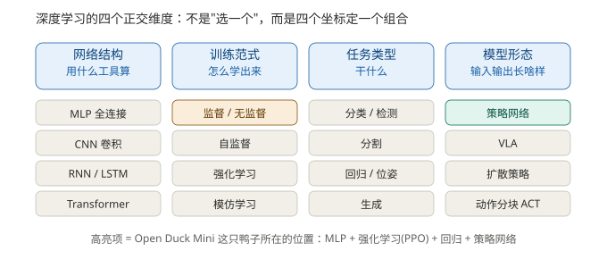
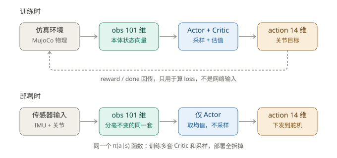
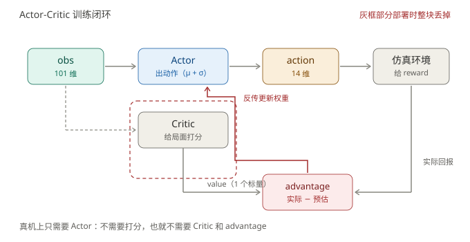
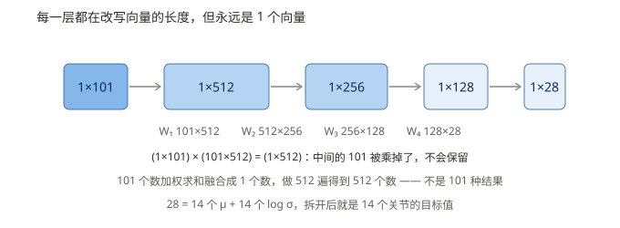
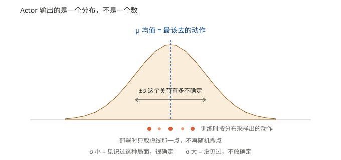
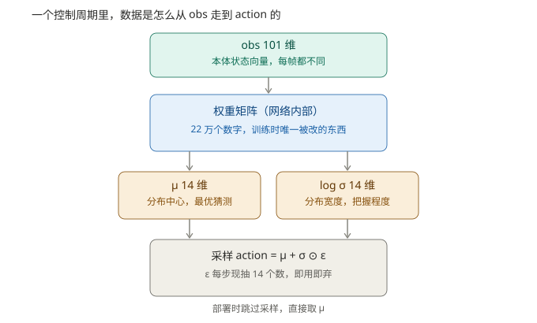
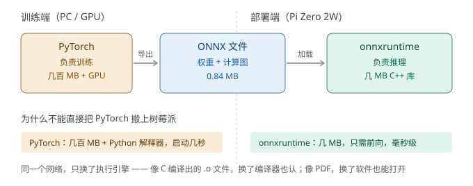
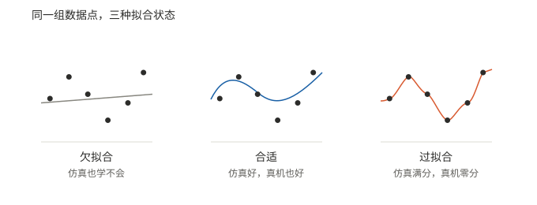
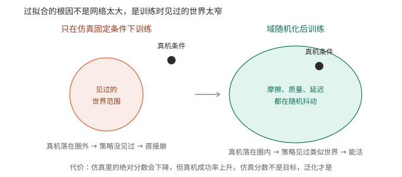

# 机器人深度学习笔记

> 以 Open Duck Mini（双足小鸭子）为载体，把"深度学习怎么用在一个真实机器人上"从概念到符号走通一遍。
> 配套文档：《机器人深度学习.md》（概念分层）、《Open_Duck_Mini_软件架构精读.md》（源码细节）。

---

## 一、先定位：深度学习在机器人技术栈里站哪一格

机器人的技术栈按**响应频率**分层，学习模块只占中间两层：

| 层面 | 职责 | 典型技术 | 频率量级 |
|---|---|---|---|
| 感知 | 看懂环境与自身状态 | CNN 检测分割、点云网络、VLM 编码器 | 10~30 Hz |
| 决策 | 决定做什么、先做什么 | LLM 任务分解、深度 RL、状态机 | 0.2~2 Hz |
| **技能控制** | 把决策变成动作序列 | **RL 运动策略**、模仿学习、扩散策略、VLA | 2~50 Hz |
| 伺服控制 | 跟踪轨迹、输出力矩 | PID、MPC、WBC、轨迹插补 | 500 Hz~1 kHz |

**关键认知**：学习模块集中在中间两层，**伺服层以经典控制为主**。所以"用深度学习"不等于"全部用神经网络"，恰恰相反，越是底层越依赖确定性控制。

本笔记的主角——双足行走策略——落在**技能控制层**，以 50 Hz 输出，下层由 1 kHz 的 PD 环跟踪。

---

## 二、深度学习的四个正交维度

**"深度学习有哪几种"是个有歧义的问题**——它不是一个维度的分类，而是四个互相独立的坐标，任意四项可自由组合。就像不能说"红色是汽车的一种"（红色是"颜色"这个维度的取值），先问清是哪个维度，才谈得上"有哪几种"。



| 维度 | 回答的问题 | 取值 | 鸭子的位置 |
|---|---|---|---|
| 网络结构 | 用什么工具算 | MLP / CNN / RNN / Transformer | **MLP 全连接** |
| 训练范式 | 怎么学出来 | 监督 / 无监督 / 自监督 / 强化 / 模仿 / 离线RL | **强化学习 PPO** |
| 任务类型 | 干什么 | 分类 / 检测 / 分割 / 回归 / 生成 | **回归**（输出 14 个连续值） |
| 模型形态 | 输入输出长啥样 | 策略网络 / VLA / 扩散策略 / 动作分块 | **策略网络** |

鸭子 = 「MLP + 强化学习 + 回归 + 策略网络」这一个组合。

> 这四个维度下 16 个取值（MLP/CNN/RNN/Transformer、监督/无监督/自监督/强化/模仿/离线RL、分类/检测/分割/回归/位姿/生成、策略网络/VLA/扩散策略/ACT）逐个的人话解释，见《深度学习术语通俗解释.md》第二部分。

### 2.1 这四个词分别是什么意思

**MLP 全连接**

全连接 = 这一层的每一个神经元，都和上一层的所有神经元连着。落到计算上就是一张矩阵乘法表：101 个输入对 512 个输出，中间就有 101×512 个连接系数。

它不做任何"只看局部"的假设，所有输入一视同仁地全连起来。鸭子用它，是因为输入是一个 101 维拼好的向量，不像图像那样有空间邻接关系可挖，全连接就够。

**强化学习 PPO**

强化学习的大白话：**训练时从分布里随机采样动作，环境给分数，根据分数往回调整，让机器慢慢明白"什么输入下做什么动作分数最高"。**

PPO 是强化学习里的一种具体算法，特点是**每次只允许小步更新**，防止一改改太猛，把已经学好的策略毁掉。

一句话：试错 → 打分 → 小步改。

**回归**

回归 = 输出的是**连续数值**，不是离散类别。

鸭子输出 14 个关节角度（弧度值），全是连续量，所以是回归。对比一下：输出"猫/狗"是分类，输出"膝关节 1.37 rad"是回归。

**策略网络**

策略（policy）就是"给定状态，该做什么动作"这个映射，记作 π(a|s)。

**策略网络 = 用神经网络来表示这个映射。** 它不预测"世界会变成什么样"，只决定"我该怎么做"。

在 RL 里它还有个更常用的名字：**Actor（演员）**。与它配对训练的是 **Critic（评论家）**，一个负责出动作、一个负责打分，3.2 节专门讲。

### 训练范式详解（这一维最容易被混为一谈）

**先回答一个高频问题：监督学习是指学习方式吗？**

**是。** 它属于「训练范式」这一维，是同维度下的六个取值之一，而不是"深度学习的一个种类"。它和强化学习是**并列**关系，不是包含关系。

| 范式 | 学什么 | 信号从哪来 | 机器人里的典型用法 |
|---|---|---|---|
| 监督学习 | 输入→标签的映射 | 人工标注的正确答案 | 视觉检测、6D 位姿估计 |
| 无监督学习 | 数据的内在结构 | 无标签，自己找规律 | 异常检测、聚类 |
| 自监督学习 | 自己给自己造标签 | 从数据本身构造 | 大模型预训练 |
| **强化学习** | 什么动作能拿高分 | 环境奖励，靠试错 | **走路、平衡** |
| 模仿学习 | 专家怎么做 | 人遥操作的示范 | 抓取、装配 |
| 离线 RL | 从历史数据学策略 | 固定数据集 + 奖励 | 不敢在线试错的场景 |

**三种范式的本质差异：**

- **监督**：每步都有"正确答案"，学的是**复制**。
- **强化**：没有正确答案，只有"做得好/坏"的分数，且常延迟几十步，学的是**试错**。
- **模仿**：有人做给你看，学的是**照抄**，快但天花板受示范质量限制。

---

## 三、一个策略网络到底在算什么

### 3.0 训练与部署：同一个函数，两套外挂



被问得最多的两个问题是：**训练时的输入输出是什么？训练完加载模型后，输入输出又是什么？**

图上这两行就是同一个函数 `π(a|s)` 的两种运行方式。差别只在：训练多套了两样"学习用的外挂"，部署全拆掉。

| 阶段 | 输入 | 网络 | 过程 | 输出 |
|---|---|---|---|---|
| **训练时** | obs 101 维 | Actor + Critic | 前向算 μ 和 σ → **从分布里随机采样** → 得动作 → 回灌仿真 → 拿 reward → 算优势 → 反传改权重 | ① 动作分布（28 维 = 14 μ + 14 log σ）<br>② value（1 个标量） |
| **部署时** | obs 101 维（**一个数都不差**） | **仅 Actor** | 只跑前向，**不采样**，直接取 μ，经 tanh 压到 [−1,1] | 14 维关节目标 |

**三句话记住差别：**

1. **输入**：都是 obs 101 维。训练时来自仿真，部署时来自真机传感器，但**向量的构造方式必须逐位一致**。
2. **过程**：训练多两步——"从分布里采样"和"回头改权重"；部署只有一步——"算出来直接用"。
3. **输出**：训练要两样（动作分布 + value，因为要学习），部署只要一样（14 个关节目标，因为只干活）。

至于 reward 和 done：**它们不是网络的输入**，是环境反馈，只参与 loss 计算，图上那条虚线就是它。这一点在第五节再展开。

图上那两个框——"Actor + Critic" 和 "仅 Actor"——3.2 节专门讲。

### 3.1 输入 obs：不是传感器原始流，是构造出来的向量

鸭子的观测是 **101 维一维向量**，构成如下：

| 分量 | 维度 | 来源 | 说明 |
|---|---|---|---|
| gyro | 3 | IMU | 角速度 |
| acc | 3 | IMU | 加速度 |
| cmds | 7 | 遥控/上位机 | 前进、转向等指令 |
| dof_pos | 14 | 关节 | 关节位置 |
| dof_vel | 14 | 关节 | 关节速度 |
| last_action | 14 | 自己 | 上一帧输出的动作 |
| last2 | 14 | 自己 | 上两帧 |
| last3 | 14 | 自己 | 上三帧 |
| motor_targets | 14 | 自己 | 上一帧下发的目标 |
| feet | 2 | 足底开关 | 左右脚触地 |
| phase | 2 | 程序生成 | 步态相位时钟 |
| **合计** | **101** | | |

**必须理解的三点：**

1. **历史动作也是输入**。`last_action / last2 / last3` 是自己过去三帧的输出。这让策略知道"我刚才在干嘛"，是学会协调的前提。
2. **phase 不是传感器，是程序算的时钟**。它本质是步态发生器——实测证明只转 phase、冻结其他观测，14 个关节就能走出交替步态。
3. **不是"喂一张图"，是"喂一个拼好的特征向量"**。哪几维、什么顺序、怎么归一化，全由人设计，这叫**观测契约**。

### 3.2 Actor 与 Critic：图上那两个框是什么

3.0 那张图里，训练那行中间写的是 **Actor + Critic**，部署那行只写 **仅 Actor**。这两个词是整张图的关键，单独讲清楚。



**Actor（策略网络，演员）**

- 职责：看 obs，出动作。**它是唯一会上真机的部分。**
- 输出：μ 和 σ（14 + 14），即"最想去的关节目标"和"有多没把握"（3.4 节细讲）。
- 目标：让总回报最大。学得好不好，直接体现在鸭子的步态上。

**Critic（价值网络，评论家）**

- 职责：看 obs，**给这个局面打分**——估计"从当前状态往后还能拿多少总回报"。
- 输出：**1 个标量 value**，不是动作。
- 目标：把分数估准。它的答案由后续真实发生的回报来校准。
- 它**不产生任何动作**，只服务于训练。

**为什么非要 Critic：因为 reward 没有参照系**

同样是"前进 0.1 m"的奖励，在快要摔倒时是奇迹，在平稳行走时是日常。**原始 reward 不带参照，Actor 不知道自己该高兴还是该沮丧。**

Critic 提供的就是这个参照系（基线 baseline）：

```
advantage = 实际拿到的回报 − Critic 预估的回报
```

- 实际 > 预估 → advantage 为正 → 这个动作**比预期好**，鼓励多做
- 实际 < 预估 → advantage 为负 → 比预期差，抑制它

这套结构叫 **Actor-Critic**，PPO 就属于这一类。好处是**方差大幅下降**：不比绝对分数有多高，只看"比预期好多少"，学得快得多。

**一个类比**

Actor 是学生答题，Critic 是旁边估分的老师。学生交答案，老师估"这题大概能得几分"。真实分数下来，两者一减：

- 比老师估的高 → 这个解法有惊喜，保留
- 比估的低 → 这个解法不行，改掉

老师自己也在学，估得越来越准。**但考试（真机）只需要学生答题，不需要老师跟着进场**——这就是部署时 Critic 被整块拆掉的原因。

| 对比 | Actor | Critic |
|---|---|---|
| 干什么 | 出动作 | 给局面打分 |
| 输出 | 14 维动作分布 | 1 个标量 |
| 部署时 | **保留** | **丢掉** |
| 类比 | 学生答题 | 老师估分 |

### 3.3 Actor 内部：101 怎么变成 28

网络是全连接的（MLP），层层做矩阵乘法：



**最容易被误解的一点**：101 不会一直保留。

```
(1 × 101) × (101 × 512) = (1 × 512)
              ↑
        中间的 101 被"乘掉"了
```

展开看第一个输出是怎么来的：

```
输出₁ = obs₁·w₁ + obs₂·w₂ + ... + obs₁₀₁·w₁₀₁
```

**101 个数加权求和，融合成 1 个数。** 做 512 遍得 512 个数。所以：

- 101 是"特征数"，不是"样本数"
- 全程只有 **1 行**，不存在"101 种结果选一个"
- 512/256/128 是**超参数**（层宽度），101 和 28 是被契约钉死的

> 上面那些 `w` 就是**权重**，它们是 ONNX 文件里占地方最多的东西，4.2 节专门拆开看。

那最后这 28 个数到底是什么？答案是 14 个均值 + 14 个标准差——3.4 节拆开。

### 3.4 μ、σ、ε：动作是怎么采出来的



网络输出的不是一个动作，而是一个**动作分布**（对角高斯）：

| 符号 | 身份 | 维度 | 随输入变？ | 训练时被更新？ | 部署时用？ |
|---|---|---|---|---|---|
| **μ** | 分布均值，即最优猜测 | 14 | 是 | 间接（权重变则变） | **是** |
| **σ** | 分布宽度，即把握程度 | 14 | 看实现（见下） | **是，直接更新** | 否 |
| **ε** | 标准正态随机噪声 | 14 | 每步现抽 | 否 | 否 |

**σ 和 μ 的身份不一样**：μ 一定是网络**算出来的输出**；σ 在常见实现里是一组**可学习参数**（14 个数），也有些实现让它由网络额外输出一路、随 obs 变化。

你这只鸭子导出的 ONNX 输出 28 维、劈成 mean 和 log_std 两半，属于后一种——**同一个网络，不同局面能给出不同的把握程度**。两种实现都能训练，区别只在于"允不允许某些局面更没底"。

采样公式：

```
action = μ + σ ⊙ ε,    ε ~ N(0,1)
```

**先解释 N(0,1) 是什么**

N(0,1) = **标准正态分布：均值为 0、方差为 1 的正态分布**。写成 N(μ, σ²) 时，括号里第一个是均值、第二个是方差，所以 N(0,1) 就是"中心在 0、胖瘦为 1"的那条标准钟形曲线。

| 性质 | 含义 |
|---|---|
| 均值 0 | 抽出来的数**正负各半**，不会系统性偏一边 |
| 方差 1 / 标准差 1 | 大约 68% 的数落在 [−1, +1]，95% 落在 [−2, +2] |
| 形状固定 | 钟形曲线永远长这样，**但每次抽出的具体数值是现算的，不是查表** |

最后一条值得强调：曲线形状是固定的，值不是。程序里用伪随机数生成器实时产生，所以两次训练抽到的 ε 序列不会相同（除非固定随机种子做复现）。

**ε 的三条要点：**

1. ε 来自 **N(0,1)**，**有正有负**。若只能取正，策略会带系统性偏差，永远学不正。
2. ε **无量纲**，是"偏几个标准差"的倍率，不是关节位置。
3. **它每步现抽、用完即弃**，不是可学习参数。

具体算例：

| 关节 | μ (rad) | σ (rad) | ε（抽到的） | 实际动作 = μ + σ·ε |
|---|---|---|---|---|
| 左膝 | 1.368 | 0.10 | −1.30 | 1.238 |
| 右髋 | 0.635 | 0.05 | +0.42 | 0.656 |

**为什么要加 ε**

只有探索才能发现"别的走法可能更好"。若每步只输出 μ，策略永远走同一条路，永远不知道旁边是不是有更好的解法。

**用一句话把 μ + σ·ε 解释清楚：**

> 实际动作 = μ + σ·ε。
> σ 对 μ 越确定（σ 小），探索程度就越小；σ 对 μ 越不信任（σ 大），就更需要探索。
> 探索出来的结果拿去**更新权重**，权重再**更新出新的 μ**。

所以 σ 是一个"该多大程度瞎试"的旋钮，而它自己也是被训练出来的——**试得越准，σ 越小；越没底，σ 越大**。

**为什么部署只取 μ**：
1. 要的是最优解，不是随机解
2. 确定性才能复现和调试
3. σ 训练后本来就收缩到很小，μ 已接近采样值

**σ 的物理含义**：它是"自信程度"。σ 小 = 这种局面见得多、很确定；σ 大 = 没见过、不敢确定。训练学到最后，σ 会慢慢往 0 收缩，因为策略对越来越多的局面有把握了。

### 3.5 完整数据流



---

## 四、ONNX：模型文件里到底装了什么

### 4.1 ONNX：为什么要把模型翻译一遍

**一句话：ONNX 是模型的通用交换格式。**



3.0 那张对比表里有一条很关键：网络结构在训练和部署时**完全一样**，只是拆掉了训练期专属的部分。**这就是同一个 ONNX 能直接搬上真机的原因**——从 PyTorch 到真机，差的只是一个格式转换。

训练用 PyTorch，但真机（树莓派 / Pi Zero 2W）上装 PyTorch 又大又慢：

| 对比项 | PyTorch | onnxruntime |
|---|---|---|
| 体积 | 通常几百 MB 起 | 几 MB 级 |
| 依赖 | Python 解释器 + 一大串库 | 一个 C/C++ 库即可 |
| 启动 | 慢（导入就要几秒） | 快 |
| 适合 | **训练**（要自动求导、要 GPU） | **推理**（只要前向） |

所以链路是：**PyTorch 训练 → 导出 ONNX → 真机用 onnxruntime 加载推理**。

类比一下：

- 像 C 语言编译出的 `.o` 中间文件——不管哪个编译器产出的，链接器都认
- 像 PDF——不管用什么软件写的，任何设备都能打开

ONNX 文件里装两样东西：**权重数值 + 计算图结构**。少了任何一样都跑不起来——只有数值不知道该怎么算，只有结构没有数值算不出东西。

> 你这只鸭子的 `BEST_WALK_ONNX_2.onnx` 是 0.84 MB、opset 11。开头两个算子 `Sub + Mul` 就是训练时的观测归一化常数（202 个数），说明归一化已经**烘焙进图**了，部署端喂原始 obs 即可，不用自己再算一遍。

### 4.2 ONNX 里装的东西：权重、偏置、SiLU

上节说 ONNX 文件里装两样：**权重数值 + 计算图结构**。这一节把这两样拆开看——所谓"模型"，本质就是一堆权重矩阵加几个非线性函数。

**权重（Weight）**：矩阵里的数字，全网络共 **22 万个**，就是训练时唯一被改动的东西。

**权重的作用只有一句话：决定 "obs 怎么变成 μ"。** 写成式子就是：

$$\mu = W_3 \cdot \text{SiLU}\big(W_2 \cdot \text{SiLU}(W_1 \cdot obs + b_1) + b_2\big) + b_3$$

> 注：这是三层的简化写法，只为抓住"权重怎么把 obs 变成 μ"这个结构。实际网络是四层（最后还有一层 128 → 28），输出 28 维再切成 14 个 μ + 14 个 log σ。多一层少一层不改变本质。

这里面的 **W₁ W₂ W₃ 和 b₁ b₂ b₃ 就是全部权重**。它们没有任何别的含义——不是动作、不是关节位置、不是 14 维向量。它们只是一堆**换算系数**，作用是"把 101 个数按某种配方混合成 14 个数"。

三个层次必须分清：

| 对象 | 是什么 | 数量级 | 随输入变吗 | 训练时被改吗 |
|---|---|---|---|---|
| **权重 W / 偏置 b** | 网络内部的换算系数 | 22 万个 | 不变，冻住的 | **是，只改它们** |
| **μ** | 权重算出来的**结果** | 14 个 | 每帧都变 | 否，只是跟着变 |
| **action** | μ 加噪声后的**实际下发值** | 14 个 | 每帧都变 | 否 |

> 一句话：**权重是机器的内部构造，μ 是机器每次吐出来的产品。** 训练就是反复微调这台机器，让同样的 obs 进来能吐出好动作。

算一笔账验证 22 万这个数：

| 部分 | 计算 | 数量 |
|---|---|---|
| W₁ | 101 × 512 | 51,712 |
| W₂ | 512 × 256 | 131,072 |
| W₃ | 256 × 128 | 32,768 |
| W₄ | 128 × 28 | 3,584 |
| 偏置 b₁~b₄ | 512+256+128+28 | 924 |
| 归一化常数 | 101 个均值 + 101 个方差 | 202 |
| **合计** | | **220,262** |

与 ONNX 实测的 220,262 参数**完全一致**。

**偏置（Bias）**：`y = Wx + b` 里的 b，作用是把结果**整体平移**。

- 类比 `y = ax + b`：a 是权重（斜率），b 是偏置（截距）
- 对做硬件的更贴切：**像运放的输入失调电压**，不管输入是什么，先把信号挪一个常数
- 没有 b 的话，输入全 0 时输出必然全 0，网络无法表达"输入为零但该输出非零"
- **注意术语**：偏置不是"微调"。fine-tuning（微调）是另一个概念

**SiLU（激活函数）**：

$$\text{SiLU}(x) = x \cdot \sigma(x),\quad \sigma(x)=\frac{1}{1+e^{-x}}$$

| 特性 | ReLU | SiLU |
|---|---|---|
| 公式 | max(0, x) | x · sigmoid(x) |
| x < 0 | 直接归 0 | 保留一个小负值 |
| 梯度 | 负区为 0，可能神经元死亡 | 处处平滑可导 |
| 曲线 | 折角 | 光滑 |

**为什么必须有它 —— 手算一遍就懂了**

先看纯线性叠两层：

```
h = 3x + 1
y = 2h + 4 = 2(3x + 1) + 4 = 6x + 6
```

叠完还是 `ax + b` 的形式，只是**斜率从 3 变成 6、截距从 1 变成 6**。换句话说，不管叠多少层，只要全是线性，最后都能折叠回一个 `ax+b`，等于白叠——没有加入任何新东西。

中间插一个 SiLU：

```
h = SiLU(3x + 1) = (3x + 1) · σ(3x + 1)
y = 2h + 4 = 2(3x + 1) · σ(3x + 1) + 4
```

代进去之后，**已经不是 ax + b 的形式了**——括号里冒出了 `σ(3x+1)` 这个非线性项，折不动了，线就开始弯。网络这才有了拟合"obs → 动作"这种弯曲映射的能力。

> ONNX 里 SiLU 表现为 `Sigmoid → Mul`，先算 sigmoid 再乘回原值，正好对应 `SiLU(x) = x · σ(x)`。

### 4.3 训练时的输出为什么是 28 维

Actor 网络最后吐出 **28 个数**，不是 14 个。这 28 个数一分为二：

| 段 | 维数 | 含义 | 怎么用 |
|---|---|---|---|
| 前 14 | 14 | **μ**（均值） | 直接就是"最想去的关节目标" |
| 后 14 | 14 | **log σ**（标准差取对数） | 取 exp 才得到真正的 σ |

为什么存 log σ 而不是 σ？两个原因：

- **σ 必须是正数**，但网络输出可正可负。存 log σ 就不用加约束——`exp(任何实数)` 永远是正的。
- **数值更稳**。σ 可能小到 1e−4，直接存容易溢出或丢精度，取对数后落在正常范围。

所以 `σ = exp(log_σ)`。你在 ONNX 里看到的 `Split(14 + 14)` 就是这一刀。

顺带说明：log σ 作为网络的**一路输出**，意味着同一个网络面对不同局面可以给出不同的 σ——走平地和走碎石地的"把握程度"本来就不该一样。

再回头看 3.2：Critic 只出 1 个标量、不进真机，所以真机上跑的 ONNX 只要 Actor 那部分——这也是导出的模型只有 0.84 MB 的原因。

---

## 五、训练怎么把权重改对（一句话版）

```
探索（加 ε）→ 采到"哪个动作真的好"的数据 → 算优势 advantage → 算梯度 → 更新权重
```

中间"算优势"那一步就是 3.2 讲的 Critic 在干活：Critic 估分，实际回报减掉预估分，得到 advantage。

**梯度**这个词说白了就是"每个权重该往哪个方向挪、挪多少"的信号。它由 loss 对权重求导得到，方向指向"让好动作更可能、坏动作更不可能"。这一整套（求导 + 反向传播）PyTorch 都会自动做，你不用手算。

三个要点：

1. **不是"更新 μ"**。μ 是输出，永远不单独更新；权重变了，μ 跟着变。
2. **reward 不是网络输入**，是环境反馈，只参与 loss 计算。
3. **PPO 是整条链路里工作量最小的一环**（Brax 里调一个 `train` 函数），真正吃时间的是 **MDP 建模（奖励设计）** 和 **sim2real（执行器辨识）**。

---

## 六、欠拟合与过拟合



| 项目 | 欠拟合 | 过拟合 |
|---|---|---|
| 本质 | 学都学不动 | 学得太死，换环境就废 |
| 训练表现 | 差 | 极好 |
| 新数据表现 | 差 | 差 |
| 鸭子上长什么样 | 仿真里站不稳、走两步就摔 | 仿真走得漂亮，真机一换条件就崩 |
| 根因 | 网络太小 / 奖励太稀疏 / 步数不够 | **训练分布太窄**（不是网络大） |
| 对策 | 让**模型更强**：加容量、加训练、改奖励 | 让**世界更多样**：域随机化、加噪声、加扰动 |

**用大白话复述一遍**

- **欠拟合**：网络太小、奖励设计太难（信号太稀疏，它根本不知道该干嘛）、训练步数不够。表现是仿真里鸭子站都站不稳、走两步就摔；你加大步数，它还是和傻子一样，那吊样一点没变。解法是加大网络、优化奖励设计、多训一会儿。
- **过拟合**：训练分布太窄 → 只见过一种世界 → 换个世界就废。熟悉的东西表现特别好，不熟悉的东西直接懵逼，不会举一反三。解法是域随机化——训练时把摩擦、质量、电机延迟、观测噪声都随机化，逼它学"在所有这些条件下都能活的通用走法"，而不是"某一种条件下的最优走法"。

> **两句话记死**：欠拟合 → 让**模型更强**；过拟合 → 让**世界更多样**。

### 两个容易搞错的地方

**错误 1：以为过拟合是因为网络太大。**

这在**监督学习**里成立（数据固定有限，网络大了就背答案），但在 **RL 里不成立**：

- RL 的数据是策略自己在仿真里跑出来的，理论上无限
- 鸭子才 22 万参数，对 101 维输入不算大

正确的因果链是：

```
不是：网络太大 → 记住细节 → 过拟合
而是：训练分布太窄 → 只见过一种世界 → 换个世界就废
```

**它不是因为"记性太好"而失败，是因为"见识太少"而失败。**

所以缩网络治不了 sim2real gap，只会走向欠拟合。

**错误 2：两种病的药不一样，方向反了越调越糟。**

- 欠拟合 → 调**模型**（更强）
- 过拟合 → 调**环境**（更多样）

### 怎么判断自己处于哪个状态

别只看训练 reward，要**造一个没见过的环境去测**：

| 判据 | 结论 |
|---|---|
| 训练 reward 低，换环境也低 | 欠拟合 |
| 训练 reward 高，加扰动后骤降 | 过拟合 |
| 训练 reward 高，扰动下也稳 | 合适 |

### 排查优先级

1. 先怀疑**奖励设计**（最常见、最致命）
2. 再怀疑**训练步数**（最容易误判，和容量不足长得一样）
3. 最后才动**网络容量**（改起来最贵）

---

## 七、sim2real 与域随机化



RL 的过拟合，名字就叫 **sim2real gap**。它的四种典型形态：

| 形态 | 表现 |
|---|---|
| 依赖固定物理参数 | 仿真摩擦固定 0.8，策略靠它硬蹭；真机地面不同就打滑 |
| 依赖固定质量/惯量 | 装上电池、换舵机、加外壳后质心变化 → 崩 |
| 利用仿真器漏洞 | 靠高频抖动骗奖励，真机做不到 |
| 奖励黑客（reward hacking） | 奖励写歪了，它学会原地蹦高拿分而不是走路 |

**核心对策：域随机化（Domain Randomization）**

训练时把摩擦、质量、电机延迟、观测噪声都随机化，逼策略学"在所有这些条件下都能活"的通用走法。

**代价必须接受**：仿真里的绝对分数会下降，但真机成功率上升。

> **仿真分数不是目标，泛化才是。**

对执行器层面更细的手段是 **BAM 执行器辨识**（摩擦、电压降、回差、指令延迟），上游原文说得很直接：*actuator fidelity is most of the sim2real gap*。

---

## 八、实例对照：Open Duck Mini

| 环节 | 具体值 |
|---|---|
| 观测 | 101 维（见 3.1） |
| 动作 | 14 维关节目标 |
| 网络 | MLP 101 → 512 → 256 → 128 → 28 |
| 参数 | 220,262（0.84 MB） |
| 控制频率 | 策略 50 Hz，PD 1 kHz |
| PD 参数 | Kp=30，**Kd=0**（阻尼靠舵机固件+机械摩擦）<br>*注：30 是真机 Runtime 的姿态控制参数；仿真 MJCF 里 position 执行器是 `kp=13.37 / kv=0`（BAM 辨识的等效增益），两者不必相同，仿真以 MJCF 为准* |
| 推理耗时 | 平均 0.018 ms，占 20 ms 预算 **0.09%** |
| 真正的瓶颈 | 舵机总线（1 Mbps TTL），不是算力 |
| 训练栈 | mujoco_playground（MJX，JAX 版 MuJoCo）+ **Brax PPO**；4096 envs |
| ONNX 输出 | 28 维（14 μ + 14 log σ），导出后推理只取前 14 |
| 导出格式 | ONNX（opset 11），归一化烘焙进图（开头 `Sub + Mul`） |

**几个关键细节：**

- **推理只占 0.09%** → 所以选大网络（512 起手）无所谓，瓶颈完全在总线和机械
- **Kd=0** → 换舵机必崩步态，因为阻尼是舵机固件+机械摩擦提供的
- **hip_pitch 左右符号相反**（left −0.630 / right +0.635），镜像关节轴定义
- **init_pos 是蹲姿不是站姿**（knee 1.368 rad ≈ 78°）

---

## 九、术语速查

| 缩写 | 全称 | 含义 |
|---|---|---|
| MLP | Multi-Layer Perceptron | 全连接网络，本鸭子用的 |
| obs | Observation | 观测向量，网络输入 |
| μ / σ | mean / std | 动作分布的均值与标准差 |
| ε | epsilon | 标准正态随机噪声 |
| PPO | Proximal Policy Optimization | 最常用的策略梯度算法 |
| Actor | 策略网络（演员） | 看 obs 出动作，**唯一上真机的部分** |
| Critic | 价值网络（评论家） | 看 obs 打分，只服务训练，部署时丢弃 |
| AC | Actor-Critic | PPO 所属的架构族 |
| advantage | 优势函数 | 实际回报 − Critic 预估，决定动作该鼓励还是抑制 |
| RL | Reinforcement Learning | 用奖励信号试错学策略 |
| IL / BC | Imitation / Behavior Cloning | 从示范学；BC 是最朴素的版本 |
| ACT | Action Chunking with Transformers | 一次预测一段动作 |
| VLA | Vision-Language-Action | 图+文→动作的多模态模型形态 |
| sim2real | Simulation to Reality | 仿真训练、真机部署 |
| DR | Domain Randomization | 域随机化，抗 sim2real gap 的核心手段 |
| ONNX | Open Neural Network Exchange | 模型通用交换格式 |
| onnxruntime | ONNX Runtime | 轻量推理引擎，真机上加载 ONNX 用它 |
| N(0,1) | 标准正态分布 | 均值 0、方差 1，ε 从这里抽 |
| log σ | log standard deviation | 网络输出的后 14 维，取 exp 才得 σ |
| VLA / MPC / WBC | — | 见《机器人深度学习.md》 |

---

## 十、常见误区清单

1. **以为"深度学习有哪几种"能横向比较** —— 它是四个正交维度，不能混着选。
2. **以为监督学习是深度学习的一种** —— 它是"训练范式"这一维的取值。
3. **以为 ε 取 [0,1]** —— 是 N(0,1)，有正有负。否则策略带系统性偏差。
4. **以为"训练时在更新 μ"** —— 更新的是权重，μ 是结果。
5. **以为 ε 是关节位置** —— 它是无量纲倍率，乘上 σ 才有量纲。
6. **以为 σ 是"最优值"** —— 最优值是 μ，σ 是把握程度。
7. **以为 101 → 512 会得到 101 行** —— 全程只有 1 行，101 被乘掉了。
8. **把"偏置"叫成"微调"** —— 微调是 fine-tuning，是另一个概念。
9. **以为过拟合是网络太大** —— RL 里主因是训练分布太窄。
10. **以为仿真分数越高越好** —— 泛化才是目标，域随机化必然降低仿真分数。
11. **10 Hz 推理直接接 1 kHz 伺服** —— 中间必须有插补与平滑，否则台阶与抖动。
12. **让学习模块进安全链** —— 安全判断要确定性，应由独立环节校验与限幅。
13. **以为训练和部署的输入不一样** —— 都是 obs 101 维。训练时来自仿真，部署时来自传感器，但构造方式逐位一致。契约不对齐，训练再好真机也是乱的。
14. **以为 ONNX 是一种训练框架** —— 它是模型的**交换格式**。训练仍在 PyTorch 里做，ONNX 只负责"搬到轻量环境里能跑"。
15. **以为 N(0,1) 是一张要查的表** —— 曲线形状固定（均值 0、方差 1、68% 落 ±1），但每次抽出的数值是现算的。
16. **以为 Critic 也要上真机，或以为 Actor/Critic 是同一个网** —— 两套网络、两个职责：Actor 出动作（唯一上真机），Critic 打分（训练期陪练，部署连同 advantage 整块丢弃）。

---

## 十一、面试可讲的三句话

如果被问到"你的深度学习能力"，可以这样收口：

1. **分层定位**：机器人技术栈按频率分四层，学习只占决策与技能控制层，伺服层仍是经典控制。我做的是技能控制层的 RL 运动策略。
2. **符号闭环**：能讲清 obs → Actor → μ/σ → 采样 → action 的全链路，以及 Critic 打分、advantage 回传、更新权重这条训练回路；包括 22 万参数怎么来的、为什么部署只取 μ、为什么 Critic 不进真机、为什么 Kd=0 换成舵机就崩。
3. **工程判断**：过拟合在 RL 里的真实形态是 sim2real gap，根因不是网络容量而是分布太窄，对策是域随机化 + 执行器辨识，代价是仿真分数下降。

---

*笔记基于 Open Duck Mini 实录 + 通用深度学习原理整理，量化数据均来自本地 ONNX 实测。*
